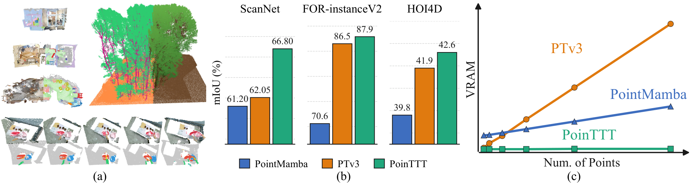

# Recurrent Point Transformer via Test-Time Training

[](https://arxiv.org/abs/2611.29059)
[](https://github.com/UVA-Computer-Vision-Lab/pointtt/releases/tag/v1.0.0)
[](LICENSE)

**[Wentao Zhou](https://zwt.zip/)<sup>1,2</sup>, [Xuweiyi Chen](https://xuweiyichen.github.io/)<sup>1</sup>, Charles Saunders<sup>3</sup>, [Aruni RoyChowdhury](https://arunirc.github.io/)<sup>3</sup>, [Zezhou Cheng](https://sites.google.com/site/zezhoucheng/)<sup>1</sup>**

<sup>1</sup>University of Virginia &nbsp; <sup>2</sup>Georgia Institute of Technology &nbsp; <sup>3</sup>MathWorks



This repository provides the official implementation of PoinTTT from the paper
[*Recurrent Point Transformer via Test-Time Training*](https://arxiv.org/abs/2611.29059): training and evaluation
code, configs, and the released checkpoints for FOR-instanceV2 and HOI4D.

If you find this code useful, please consider citing:

```bibtex
@article{zhou2026pointtt,
  title   = {Recurrent Point Transformer via Test-Time Training},
  author  = {Zhou, Wentao and Chen, Xuweiyi and Saunders, Charles and RoyChowdhury, Aruni and Cheng, Zezhou},
  journal = {arXiv preprint arXiv:2611.29059},
  year    = {2026}
}
```

Environment Setup
-----------------

Linux with an NVIDIA GPU, conda (or mamba / micromamba) and gcc/g++ 9-13 (or `USE_CONDA_GCC=1`).
The script builds a conda environment in `./env` with Python 3.11, PyTorch, spconv, torch-scatter, flash-attn and
`libs/pointops`, then runs `scripts/smoke_test_env.py` (about 15 minutes; 8 GB of disk, or 12 GB for torch 2.7.1).
Run ONE of the two commands:

```bash
git clone https://github.com/UVA-Computer-Vision-Lab/pointtt.git && cd pointtt
bash scripts/setup_env.sh                    # A100, H100, ...: torch 2.5.0+cu124
TORCH_VER=2.7.1 bash scripts/setup_env.sh    # or, on Blackwell GPUs (B200): torch 2.7.1+cu128, needs glibc >= 2.32
```

The scripts use `./env/bin/python` when it exists; for an environment elsewhere set `PYTHON=/path/to/env/bin/python`.

Datasets
--------

Expected layout (other locations: set `DATA_ROOT` for the scripts below):

```
data/
├── forainetv2/
│   ├── meta_data/{train,test}_list.txt
│   ├── train_val_data/*.ply              # training only
│   └── test_data/*.ply
└── hoi4d/
    ├── train2.h5  train3.h5  train4.h5   # training only
    ├── test1_right.h5
    └── test2_right.h5
```

**FOR-instanceV2** ([Zenodo record 16742708](https://doi.org/10.5281/zenodo.16742708)). The script downloads
`test_data.zip` (377 MB), checks its md5, unpacks it and installs the official test list (28 plots); with `--train` it
also gets `train_val_data.zip` (2.4 GB, 11 GB unpacked) and the official training list (47 plots):

```bash
bash scripts/prepare_forest.sh             # evaluation
bash scripts/prepare_forest.sh --train     # training and evaluation
```

**HOI4D**. All files are in the "Sem Seg Test Set" folder on the [HOI4D page](https://hoi4d.github.io/) (the button
names only the test set, but the training files are there too). For evaluation, download `test_wolabel_seg.h5`
(52.6 GB) and `label.npy` (2.2 GB) into `data/hoi4d/SemSegChallenge/`, then split them into the two test files and
check them:

```bash
sha256sum data/hoi4d/SemSegChallenge/*
# b78bf883f9bc1e6e7ec04b05bbd0095c225ec2abcf8b3db55ae8e28f81acc7ec  data/hoi4d/SemSegChallenge/test_wolabel_seg.h5
# 78af0ac5041b2577b5c66ad31663f20116015d344315cc082e2ef4f6d307bb17  data/hoi4d/SemSegChallenge/label.npy
HDF5_USE_FILE_LOCKING=FALSE ${PYTHON:-./env/bin/python} pointcept/datasets/preprocessing/hoi4d/build_test_h5.py   # writes data/hoi4d/test{1,2}_right.h5 (55 GB)
bash scripts/check_hoi4d.sh
```

`build_test_h5.py` does not read `DATA_ROOT`; for other locations pass `--test_h5`, `--label_npy` and `--out_dir`.
`data/hoi4d/SemSegChallenge/` can be deleted afterwards. For training, also download `train2.h5`, `train3.h5`
(46.1 GB each) and `train4.h5` (44.3 GB) directly into `data/hoi4d/`: 2,221 training sequences (`train1.h5` was never
released).

```bash
sha256sum data/hoi4d/train{2,3,4}.h5
# 0df9b5c172a0ee0ce57b974cd1f956de492d81c2a2dfba2250c3c0bedbdf96a1  data/hoi4d/train2.h5
# d9ae8b613adb0da8a19f69a2dd9b1a2d3e74789726f89017f7ad50d7ba454e3e  data/hoi4d/train3.h5
# c91aaa4dc2e37495b93cde379af5c55cea36f99df75578ae61fc305a06467d79  data/hoi4d/train4.h5
bash scripts/check_hoi4d.sh --train
```

Training
--------

Both models are trained in two stages: a chunk-wise PTv3 first, then PoinTTT, which adds 8 LaCT (TTT) layers to it.
The training configs are those of the runs behind the released checkpoints, seeds included.

FOR-instanceV2 (1 GPU):

```bash
bash scripts/train.sh -d forainetv2 -c pointttt-forainetv2-stage1 -g 1 -n exp/forainetv2/stage1
bash scripts/train.sh -d forainetv2 -c pointttt-forainetv2-stage2 -g 1 -n exp/forainetv2/stage2 \
    -w exp/forainetv2/stage1/model/model_best.pth
bash scripts/test.sh -d forainetv2 -w exp/forainetv2/stage2/model/model_best.pth -n exp/forainetv2/stage2_eval
```

HOI4D (stage 1 on 8 GPUs, stage 2 on 1 GPU):

```bash
bash scripts/train.sh -d hoi4d -c pointttt-hoi4d-stage1 -g 8 -n exp/hoi4d/stage1
# or the same optimizer steps on 1 GPU, about 8 times slower (replay mode, see the config):
# bash scripts/train.sh -d hoi4d -c pointttt-hoi4d-stage1 -g 1 -n exp/hoi4d/stage1 \
#     -o "batch_size=8 num_worker=4 grad_accum_steps=8 ddp_replay_world_size=8"
bash scripts/train.sh -d hoi4d -c pointttt-hoi4d-stage2 -g 1 -n exp/hoi4d/stage2 -w exp/hoi4d/stage1/model/epoch_48.pth
bash scripts/test.sh -d hoi4d -g 4 -w exp/hoi4d/stage2/model/model_last.pth -n exp/hoi4d/stage2_eval
```

`scripts/train.sh` copies the code to `<exp>/code` and runs from there; checkpoints go to `<exp>/model`, the log to
`<exp>/train.log`. `-r true` continues a run from `<exp>/model/model_last.pth` (`bash scripts/train.sh -n <exp> -r true`;
the random data order and augmentation after the restart differ, so the result is equivalent to, not identical
with, an uninterrupted run).
`-o "key=value ..."` overrides config entries; `bash scripts/train.sh -h` lists all options.

> **Note:** Training ran on NVIDIA B200 GPUs with torch 2.7.1+cu128 (GPU memory below: nvidia-smi peaks). FOR-instanceV2
> takes about 8.5 hours (stage 1) and 9.5 hours (stage 2) on one GPU, including the evaluation after every epoch, with
> about 16 GB and 20 GB of GPU memory. HOI4D stage 1 takes about 24 minutes per epoch on 8 GPUs and about 62 GB per
> GPU (8 clips per forward pass; over 100 GB with 16, e.g. on 4 GPUs). HOI4D stage 2 needs about 32 GB and took about
> 50 minutes per epoch on one GPU in the release run, which used a batched version of the fast-weight update; the
> update in this repository handles the sequences of a batch one after the other, about 1.15 times slower per
> iteration. Both HOI4D schedules have 50 epochs; the released runs were stopped after epoch 48. A checkpoint takes
> 0.55-0.6 GB; FOR-instanceV2 stage 1 and both HOI4D stages keep one per epoch, about 25 GB per run. FOR-instanceV2
> stage 2 needs only `model_best.pth` of stage 1, so stage 1 can run with `-o "save_every_epoch=False"` (keeps every
> 10th epoch).

> **Note:** The seeds are fixed, but GPU kernels are not deterministic, so a new run reproduces the checkpoints only up
> to run-to-run variation.

Evaluation
----------

With the checkpoints in `checkpoints/` (see Pretrained Checkpoints):

```bash
bash scripts/test.sh -d forainetv2          # checkpoints/pointttt_forainetv2.pth, 1 GPU, a few minutes
bash scripts/test.sh -d hoi4d -g 4          # checkpoints/pointttt_hoi4d.pth; 1, 2 or 4 GPUs, about 75 minutes on 4 B200
```

Expected output for FOR-instanceV2 (NVIDIA B200, torch 2.7.1+cu128):

```
Val result: mIoU/mAcc/allAcc 0.8789/0.9188/0.9601.
Class_0-ground Result: iou/accuracy 0.9928/0.9956
Class_1-wood Result: iou/accuracy 0.6929/0.7786
Class_2-leaf Result: iou/accuracy 0.9511/0.9820
```

Expected last line for HOI4D (4 x NVIDIA B200, torch 2.7.1+cu128, `-g 4`, `SEQ_PER_GPU=8`):

```
[pptr_score] block=1 ts=... raw_mIoU=0.3388 pptr_mIoU=0.4257 active_classes=39 raw_mAcc=0.4442 raw_allAcc=0.7803
```

`raw_mIoU` is the mean over all 49 classes, as printed by the evaluator; the reported number is `pptr_mIoU`.

> **Note:** Without `-g`, the HOI4D evaluation uses 4, 2 or 1 GPUs (the most that are visible) and 8 sequences per GPU,
> which needs about 18 GB of GPU memory for the batch buffers alone; on smaller GPUs try `SEQ_PER_GPU=2` to `4`. Other
> settings change the random parts of the evaluation (voxel representatives, serialization order) and move the result
> by about 0.0005 (pptr_mIoU 0.425-0.426, i.e. 42.5-42.6). The reference run used 24 CPU cores and 184 GB of host
> memory for 4 GPUs. The data loaders pass batches through shared memory (about 2 GB for FOR-instanceV2, about 7 GB per
> GPU for HOI4D); in containers use `--ipc=host` or a large `--shm-size`. Logs go to `exp/forainetv2_eval/train.log`
> and `exp/hoi4d_eval/train.log` (`-n` to change). The checkpoint is loaded strictly, so a wrong file stops the run
> with an error; compare the SHA-256 below to detect a damaged download. Small differences in the last digit are
> possible on other GPU types or library versions.

Pretrained Checkpoints
----------------------

The checkpoints are attached to release [v1.0.0](https://github.com/UVA-Computer-Vision-Lab/pointtt/releases/tag/v1.0.0) of
this repository. Put them into `checkpoints/` and check them:

```bash
mkdir -p checkpoints
gh release download v1.0.0 --repo UVA-Computer-Vision-Lab/pointtt --pattern "pointttt_*.pth" --pattern SHA256SUMS --dir checkpoints
(cd checkpoints && sha256sum -c SHA256SUMS)
```

| Checkpoint | Config | Training data | Test result | Size | SHA-256 |
|---|---|---|---|---|---|
| `pointttt_forainetv2.pth` | [`pointttt-forainetv2-eval.py`](configs/forainetv2/pointttt-forainetv2-eval.py) (trained with [`stage1`](configs/forainetv2/pointttt-forainetv2-stage1.py), [`stage2`](configs/forainetv2/pointttt-forainetv2-stage2.py)) | FOR-instanceV2 training split (47 plots) | mIoU **87.9** (28 plots, all points) | 194 MB | `a82122fc110f786a07dd6785826a8d649d4be7fc84ebadffb07a66af25e5f7d8` |
| `pointttt_hoi4d.pth` | [`pointttt-hoi4d-eval.py`](configs/hoi4d/pointttt-hoi4d-eval.py) (trained with [`stage1`](configs/hoi4d/pointttt-hoi4d-stage1.py), [`stage2`](configs/hoi4d/pointttt-hoi4d-stage2.py)) | HOI4D `train2`-`train4` (2,221 sequences) | pptr_mIoU **42.6** (892 sequences, all points) | 193 MB | `ec1958f9560bc989653902a57778fd24eee688188f9d161d0f1e3d2bc56365b5` |

FOR-instanceV2 in detail: mAcc 91.9, allAcc 96.0; IoU ground 99.3, wood 69.3, leaf 95.1.
pptr_mIoU is the mean IoU over the classes that occur in the HOI4D test labels, without classes 0 and 1
(39 classes; the protocol of PPTr), computed by `scripts/pptr_miou.py`.

Acknowledgements
----------------

This code builds on [Pointcept](https://github.com/Pointcept/Pointcept) and Point Transformer V3, and on
[LaCT](https://github.com/a1600012888/LaCT) for the fast-weight layers. We thank the authors of
[FOR-instanceV2 / ForestFormer3D](https://github.com/SmartForest-no/ForestFormer3D), FOR-instance and
[HOI4D](https://hoi4d.github.io/) for releasing their data.

License
-------

The code is released under the MIT License (`LICENSE`); third-party code keeps its own notices
(`THIRD_PARTY_NOTICES.md`). The datasets are not redistributed here and have their own licences:
FOR-instanceV2 is released under GPL-3.0-or-later and includes plots of
[FOR-instance](https://doi.org/10.5281/zenodo.8287792) (CC BY 4.0); HOI4D is released under CC BY-NC 4.0.
Each checkpoint was trained on the named dataset and is subject to its terms; the HOI4D checkpoint is for
non-commercial research use only. The FOR-instanceV2 split lists in
`pointcept/datasets/preprocessing/forainetv2/meta_data/` come from ForestFormer3D (CC BY-NC 4.0).
